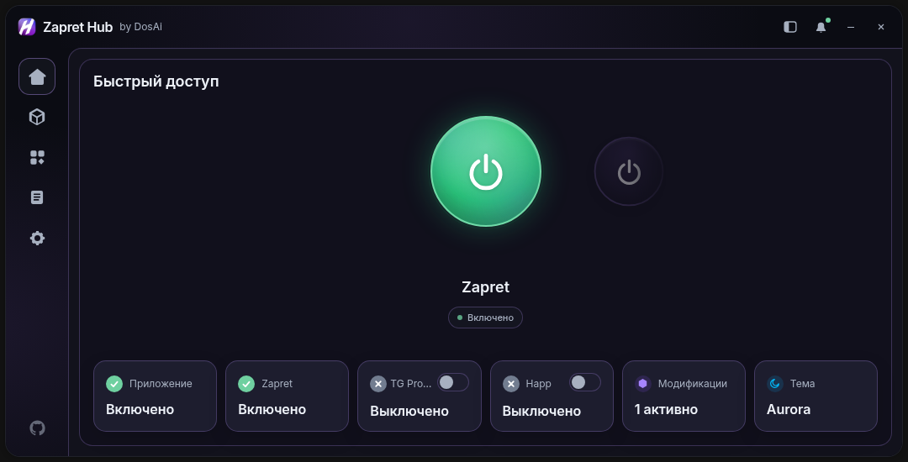
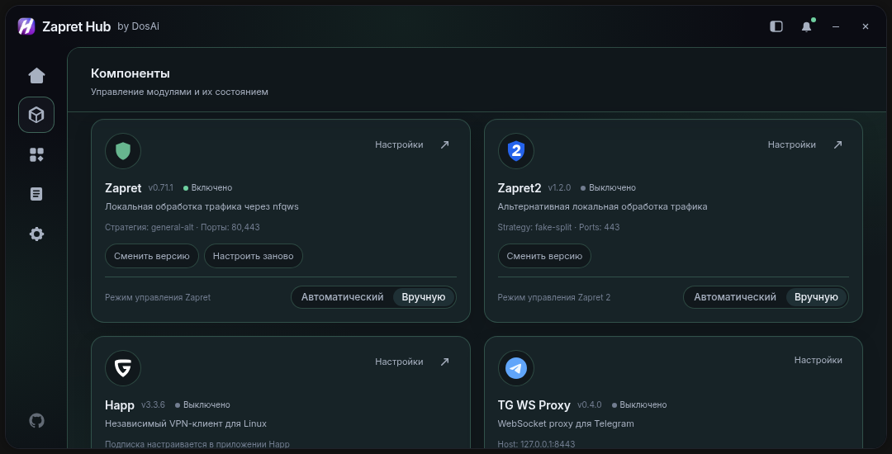
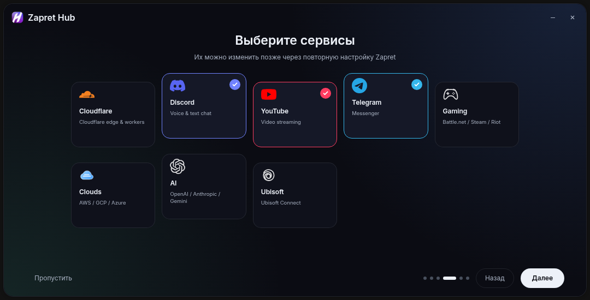

<div align="center">

# Zapret Hub Linux

A desktop control panel for Zapret, Zapret2, Happ and TG WS Proxy on Linux.

**Linux fork by [DosAi](https://github.com/DosAi)**<br>
[Repository](https://github.com/DosAi/Zapret-Hub-Linux) · [Telegram: @dosai_main](https://t.me/dosai_main)

</div>

> [!IMPORTANT]
> This is a **Linux-only** fork. Full functional testing is performed on
> **Kali Linux**; the installer is also smoke-tested in real Debian, Fedora,
> Arch and openSUSE containers.
> Windows is not supported: the repository does not ship `.exe` files, Windows
> installers or Windows instructions. Managed components require `systemd`;
> Alpine/OpenRC is deliberately unsupported for now.

[Русский README](README.md)

## What it is

Zapret Hub Linux is an experimental fork with native Linux backends based on
`systemd`, `nftables` and PolicyKit. It provides one interface for selecting a
Zapret strategy and controlling optional components. Porting, debugging, the
installer and tests were prepared by DosAi with help from **ChatGPT by OpenAI**.

## Version 3.2.0

- one-command installation of Zapret, Zapret2, Happ and TG WS Proxy;
- native Zapret and Zapret2 service control through `systemd` and `nftables`;
- strategy browsing without automatically activating the highlighted strategy;
- Happ can run independently and in parallel with Zapret or Zapret2;
- individual Happ and TG WS Proxy toggles on the main screen;
- local Telegram proxy plus a Telegram Desktop connection action;
- narrowly scoped PolicyKit authorization installed once;
- Linux-only repository and release archives with legacy Windows payloads removed.
- current Kali PolicyKit packages (`polkitd` and `pkexec`) instead of the removed
  `policykit-1` metapackage.
- experimental Debian/Ubuntu, Fedora, Arch and openSUSE installer support;
- verified official Happ packages in DEB, RPM and Arch formats;
- distribution-container smoke tests for dependency names and installer detection;
- corrected Linux `ping`, `/dev/null` and Happ version detection.

## Interface



<details>
<summary>More screenshots</summary>





</details>

The screenshots are generated from the development preview and contain no user
configuration, subscriptions or credentials.

## Install on systemd Linux

Kali Linux remains the fully tested target. Debian/Ubuntu, Fedora, Arch and
openSUSE support is experimental and covered by installer/container smoke tests.

Zapret Hub Linux is not distributed through APT, DNF or AUR and does not ship
separate DEB/RPM application packages. The supported installation method is to
download the GitHub source tree and run the root `install.sh` script.

```bash
git clone --depth 1 https://github.com/DosAi/Zapret-Hub-Linux.git && cd Zapret-Hub-Linux && ./install.sh
```

The installer prepares dependencies, Zapret, Zapret2, Happ, TG WS Proxy, the
Python environment, Web UI, PolicyKit rule and desktop entry. It does not install
Telegram Desktop unless explicitly requested:

```bash
./install.sh --with-telegram
```

Preview the installation without changing the system:

```bash
./install.sh --dry-run --no-launch
```

The installer does not start, stop or restart existing networking services.
Existing Happ and third-party Zapret installations are preserved.

## Linux updates and autostart

**Settings → Zapret Hub → Check for updates** tracks the exact commit of the
installed checkout's GitHub upstream branch (normally
`DosAi/Zapret-Hub-Linux:main`), including commits made between tagged releases.
The updater only accepts a clean fast-forward and never overwrites tracked local
changes. It refreshes the editable Python installation, rebuilds the Web UI and
restarts the application.

Zapret2 is updated separately from official `bol-van/zapret2` releases. A
Hub-managed `/opt/zapret2` installation is staged and validated first; its
configuration and user lists are preserved, the prior tree is kept for rollback,
and the service is restored to its previous state. The bundled version for new
installs is **v1.0.7**, and rerunning the installer will not downgrade a newer
managed copy.

Desktop autostart uses the stable `~/.local/bin/zapret-hub` launcher and validates
that its executable still exists instead of treating any stale desktop file as
working autostart.

## Choosing a strategy

Open **Components** and use the control mode in the Zapret or Zapret 2 card:

- **Automatic** tests YouTube and Discord connectivity and selects a strategy;
- **Manual** lets you choose the strategy in that component's settings.

A prominent guide above the component cards also provides one-click Auto tuning.
Browsing the cards on the main screen alone does not start strategy selection.

## Uninstall

Run the uninstaller before deleting the cloned source directory:

```bash
./uninstall.sh
```

The graphical uninstaller uses the same Zapret Hub UI. It removes launchers,
the PolicyKit rule, Hub-owned services, and only Zapret/Zapret2 directories with
the `.zapret-hub-managed` ownership marker. Third-party installations and shared
distribution packages are preserved. Settings/logs and Happ are separate,
explicit choices.

New installations also expose **Uninstall Zapret Hub** in the desktop
application menu, so the normal removal flow does not require a terminal.

Terminal fallback:

```bash
./uninstall.sh --cli
```

The same uninstaller detects APT, DNF, Pacman or Zypper and supports
Kali/Debian/Ubuntu, Fedora/RHEL, Arch and openSUSE.

## Components

- [zapret](https://github.com/bol-van/zapret) and [zapret2](https://github.com/bol-van/zapret2)
- [zapret-discord-youtube-linux](https://github.com/Sergeydigl3/zapret-discord-youtube-linux)
- [tg-ws-proxy](https://github.com/Flowseal/tg-ws-proxy)
- [Happ Desktop](https://github.com/Happ-proxy/happ-desktop)
- [Zapret Hub — original project and UI by goshkow](https://github.com/goshkow/Zapret-Hub)

The upstream link is retained for attribution. This fork is not an official
upstream release. Bundled projects retain their own licenses and notices.

## Diagnostics and support

```bash
.venv/bin/zapret-hub-linux diagnose
.venv/bin/zapret-hub-linux start --dry-run
.venv/bin/pytest -q
```

See [README_LINUX.md](README_LINUX.md), [CONTRIBUTING.md](CONTRIBUTING.md) and
[SECURITY.md](SECURITY.md). Bugs and Kali Linux test results can be sent through
GitHub Issues or [@dosai_main](https://t.me/dosai_main).

## License

Linux fork changes are distributed under the [MIT License](LICENSE). Bundled
projects retain their own licenses and copyright notices.
